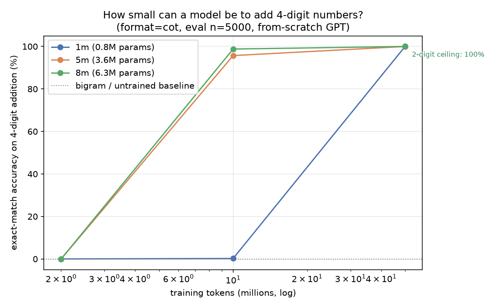

# tiny-math

**How small can a model be and still learn arithmetic? — answered.**

| | smallest that passes (≥95% on 4-digit addition) | accuracy |
|---|---|---|
| **From-scratch** (digit vocab) | **805,632 params** | **100.0%** (5000/5000) |
| **Real pretrained LLM** (fine-tuned) | **pythia-14m, 14.1M params** | **99.8%** (n=2000) |

Zero-shot, every real LLM up to 134.5M params scores **0%**. Fine-tuned,
LLMs below ~14M hit a BPE-tokenization floor (3.7M → 0.2% even with the
same 1.78M-problem budget that gave the 0.81M from-scratch model 100%).
The full story — three-panel chart, failure-mode gallery, NaN forensics,
honest disclosures: **[VERDICT.md](VERDICT.md)**.

Three structural findings: (1) capacity buys sample efficiency and the
transition is a **cliff** (0.81M: 0.2% → 100% between 357k and 1.78M
problems); (2) in-distribution perfection ≠ algorithm learning — 100% at
the trained digit-length, **0% at every other length**, with example
answers showing fixed-slot positional choreography; (3) pythia-14m's 99.8%
trained only its **1.19M transformer blocks** (vocab frozen) — nearly the
same trainable capacity as the from-scratch winner.

[Model + full results on Hugging Face](https://huggingface.co/Atharva1232/tiny-math-1m)

## Headline from-scratch results

| model (actual params) | 71k problems | 357k problems | 1.78M problems |
|---|---|---|---|
| **0.81M** | 0.0% | 0.2% | **100.0%** |
| 3.58M | 0.0% | 95.7% | 100.0% |
| 6.34M | 0.0% | 98.8% | 100.0% |



Baselines (bigram count model, untrained model): **0.0%** — the floor is
zero; everything above it is learned.

## Layout

```
VERDICT.md              # the final answer: tables, chart, disclosures
train.py                # tokenizer + data gen (3 formats) + TinyGPT + train/eval loop
baselines.py            # bigram count model + untrained-model baselines
verdict.py              # combines ALL results -> verdict.json + verdict_chart.png
make_kernel.py          # builds single-file Kaggle kernels (no sibling imports)
nan_autopsy.py          # fp16/AdamW NaN forensics (the pythia-14m saga)
MODEL_CARD.md           # honest report for the from-scratch model
STATUS.md               # full session log: bugs found, decisions, pre-committed rules
kernels/                # every GPU run: bakeoff, sweep, extrapol, quiz, stageb2-6
results/                # all raw results + charts
```

## Methodology notes (the parts that matter)

- **Contamination prevented by construction**: eval sets built before
  training streams; streams reject any eval pair; extrapolation control
  excludes train-seen pairs by exact RNG replay.
- **Exact match only**, never training loss or shaped rewards.
- **Format chosen by measurement** (3-format bake-off), not taste.
- **Independent tuning vs final eval sets** with overlap asserts.
- Eval sizes stated per table (n=5000 from-scratch, n=2000 LLMs).
- One seed per cell; disclosed. Six training rounds for the LLM arm —
  every null result, bug, and fix is in `STATUS.md`. Nothing was dropped
  for being inconvenient.

## Citation

```bibtex
@misc{atharvagupta123-tiny-math,
  title = {tiny-math: the smallest model that can do arithmetic (0.81M from scratch; 14.1M as a pretrained LLM)},
  author = {Atharva Gupta},
  year = {2026},
  howpublished = {\url{https://github.com/Its-Atharva-Gupta/tiny-math}}
}
```
