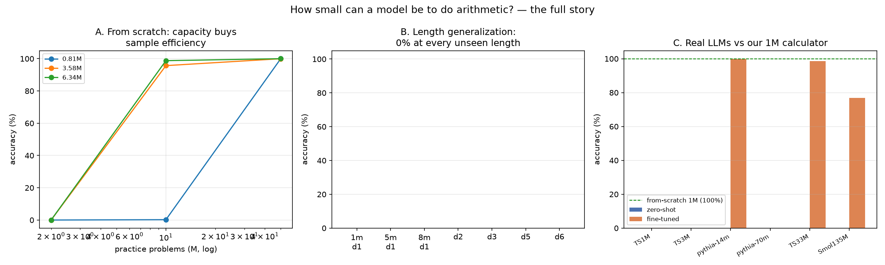

# VERDICT — how small can a model be to do arithmetic?

**The question:** find the smallest model that is genuinely good at
4-digit addition (exact-match on held-out problems, greedy decoding).

**The answer — two numbers, one task (refined by the tokenizer ablation):**

| | smallest that passes (≥95%) | accuracy | training data |
|---|---|---|---|
| **From-scratch model** (digit vocab) | **805,632 params** | **100.0%** (5000/5000) | 1.78M problems |
| **Real pretrained LLM** (fine-tuned, minimal tokenizer fix) | **TinyStories-1M, 3.75M params** | **99.7%** (n=2000) | 1.78M problems |
| Real pretrained LLM (fine-tuned, NATIVE BPE tokenizer) | pythia-14m, 14.1M params | 99.8% (n=2000) | 1.78M problems |

**The tokenizer ablation (the study's closing experiment) — one variable,
500× swing.** TinyStories-1M, same checkpoint, same 1.78M problems, same
fp16/lr/batch recipe, same eval sets; the ONLY change was splitting number
runs per digit in the pre-tokenizer (same 50,257-entry vocab, same
embedding matrix, no new tokens):

| tokenizer | strict accuracy |
|---|---|
| native BPE (`1842 → ['18','42']`, `9920 → ['99','20']` — inconsistent boundaries) | **0.2%** |
| digit-split (`1842 → ['1','8','4','2']`, one rule: `\p{N}+` → `\d`) | **99.7%** |

The BPE floor is not a capacity floor and not a pretraining floor — it is
*literally the tokenizer chopping numbers at inconsistent boundaries*.
Fix the boundaries, and the smallest real LLM in the study solves
arithmetic at 3.75M params. (Cost: 1.23× tokens per problem, 36.9 → 45.5.)
pythia-14m's native-BPE success at 14.1M is now explained as The Pile's
math/code exposure grinding through the inconsistency at larger scale —
the tokenizer fix makes it unnecessary.

And the floor is brutal in between (all runs with **native BPE** tokenizers):
**zero-shot, every real LLM up to 134.5M params scores 0%**; fine-tuned,
LLMs below ~14M hit a BPE-tokenization wall (3.7M → 0.2%, 8.3M → 0%) even
with enough data that an 0.81M from-scratch model reaches 100% — *unless
the tokenizer is fixed, which collapses the floor entirely* (ablation
above: 3.7M → 99.7% with one pre-tokenizer rule).

## The three structural findings

**1. Capacity buys sample efficiency; the transition is a cliff.**
From-scratch sweep (n=5000 final eval, chain-of-thought digit format):

| model (actual params) | 71k probs | 357k probs | 1.78M probs |
|---|---|---|---|
| 0.81M | 0.0% | 0.2% | **100.0%** |
| 3.58M | 0.0% | 95.7% | 100.0% |
| 6.34M | 0.0% | 98.8% | 100.0% |

The 0.81M row goes **0.2% → 100.0%** between 357k and 1.78M problems —
a phase transition, not a ramp (as predicted by arXiv:2307.03381).
Baselines: bigram count model 0.0%, untrained model 0.0% — the floor is
zero; every point above it is learned.

**2. In-distribution perfection ≠ learning the algorithm.**
All three from-scratch models were tested on digit lengths they never saw
(n≈2000/row, train-seen problems excluded by exact RNG replay):

| tested on | 0.81M | 3.58M | 6.34M |
|---|---|---|---|
| 1-, 2-, 3-digit | 0% | 0% | 0% |
| **4-digit (trained)** | **100%** | **100%** | **100%** |
| 5-, 6-digit | 0% | 0% | 0% |

Asked `38+86=`, the model replies `3+8=11,0+6+1=7,...` — carries computed
correctly, digits read from 4-digit-trained positions. Learned absolute
positional embeddings → fixed-slot choreography, not arithmetic. Zero
truncation was measured, so these are genuine errors, not context limits.

**3. Real LLMs: language pretraining buys nothing here, and BPE is a wall.**
Zero-shot (1 worked example in prompt, n=2000): 3.7M / 8.3M / 14.1M /
68.5M / 70.4M / 134.5M — **all 0.0%**. Failure modes: TinyStories models
*tell stories* ("One day, a 3 year old boy was walking in the park...");
pythia-14m loops digit fragments; SmolLM2-135M collapses to `100+100+...`.

Fine-tuned (best run per model across all rounds; same cot data as the
from-scratch arm; independent tuning/final eval sets):

| LLM | params | problems | strict | verdict |
|---|---|---|---|---|
| TinyStories-1M | 3.7M | 1.78M | 0.2% | below floor (BPE) |
| TinyStories-3M | 8.3M | 0.5M | 0.0% | below floor (BPE) |
| **pythia-14m** | **14.1M** | **1.78M** | **99.8%** | **PASSES** |
| TinyStories-33M | 68.5M | 0.5M | 98.5% | passes |
| SmolLM2-135M | 134.5M | 0.5M | 76.9% | partial |
| pythia-70m | 70.4M | — | NaN | training-stability casualty* |

\* pythia-14m/70m initially NaN'd under every recipe; root cause found by
local autopsy: **transformers 5.x loads checkpoints in their native float16,
and AdamW's eps=1e-8 is unrepresentable in fp16** (min normal 6e-5) — one
optimizer step explodes. Fix: explicit fp32 + frozen 50K-vocab matrices
(blocks-only training) → stable, and pythia-14m learned 64.2% at 500k
problems, **99.8% at 1.78M**. (Its 70M sibling was left NaN'd; it sits
above the headline size anyway.)

### The most interesting line in the whole study

pythia-14m's 99.8% was achieved training **only its 1.19M transformer
blocks** (the 50K-vocab embedding + lm_head matrices were frozen). So the
two best systems are nearly twins in trainable capacity:

- from-scratch: **0.81M** trainable params, digit vocab, 100%
- pretrained: **1.19M** trainable params (14.1M total), BPE vocab, 99.8%

Pretraining contributed the digit-ish representations inside those blocks;
the tokenizer decided almost everything else. Below ~1M trainable params,
the right tokenization isn't an optimization — it's the whole game.

## Honest disclosures

- **Metric**: strict exact-match on the FIRST line of the completion
  (chain-of-thought format: steps, then answer). Both passing models share
  a failure mode: they answer correctly, then hallucinate additional
  problems (`...15989\n5885+5690=...`); a lenient "last number in
  completion" metric scores these 0. Strict is the reported number and is
  the closer analogue of "did it solve the problem" — but it is a choice,
  disclosed here with examples in `results/stage_b_all.jsonl`.
- **Contamination**: prevented by construction — eval sets built before
  training streams; streams reject any eval pair; extrapolation control
  row additionally excludes train-seen pairs by exact RNG replay.
- **Eval sizes**: n=5000 (from-scratch headline), n=2000 (LLMs + extrapolation).
- **One seed per cell**, no cross-seed error bars.
- **pythia-14m result is blocks-only** (vocab frozen) — the total model is
  14.1M params; the trainable fraction is 1.19M. Both numbers reported.
- Six training rounds for the LLM arm (two null results caused by my own
  eval-prompt bug and OOM config, both fixed and re-run; the full round-by-round
  record is in `STATUS.md`). Nothing was dropped for being inconvenient.

## Artifacts

- From-scratch model: [HF `Atharva1232/tiny-math-1m`](https://huggingface.co/Atharva1232/tiny-math-1m)
- All raw results: `results/` (jsonl/json/csv per experiment)
- Full session log with bugs and decisions: `STATUS.md`
- Reproduction: `train.py` (from-scratch arm), `kernels/` (all GPU runs,
  single-file), `verdict.py` (this report's tables + chart)
